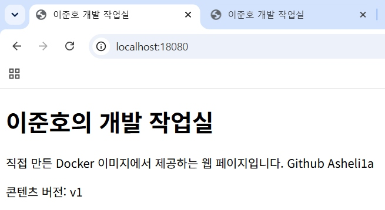
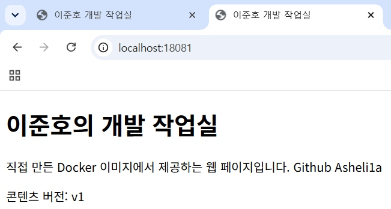

# 커스텀 웹 서버 이미지 및 포트 매핑

- 수행 일자: 2026-10-30
- 별도 clone 재검증: 2026-10-31 — 마지막 절에 분리 기록
- 실행 위치: WSL Ubuntu의 `~/dev-workstation`
- 이 문서는 당시의 실제 빌드·실행·접속 기록이다. 재현 명령은 README, 호스트 파일 변경 검증은 04-storage.md에 분리했다.
- 로그의 시각·버전·이미지/컨테이너 ID는 당시 값이다. 이미지 태그는 재사용될 수 있으므로 기록된 값과 구분한다.

## 1. 목적
NGINX 기반 커스텀 이미지를 만들고,
직접 작성한 웹 페이지의 포트 매핑 접속을 검증한다.

## 2. 베이스 이미지 및 커스텀 내용

| 항목 | 적용 내용 | 목적 |
|---|---|---|
| 베이스 이미지 | nginx:alpine | 정적 웹 페이지를 제공할 웹 서버 사용 |
| 웹 콘텐츠 | 직접 작성한 site/index.html | 기본 페이지를 실습용 페이지로 교체 |
| LABEL | Asheli1a Workspace Web | 이미지 식별 정보 추가 |
| 서비스 포트 | 80/tcp | 컨테이너의 웹 서비스 포트 명시 |

- [웹 소스](../site/index.html)
- [Dockerfile](../Dockerfile)
- [빌드 제외 설정](../.dockerignore)

## 3. 소스 및 설정 확인
```console
$ nano site/index.html
$ cat site/index.html
<!doctype html>
<html lang="ko">
<head>
  <meta charset="utf-8">
  <meta name="viewport" content="width=device-width, initial-scale=1">
  <title>이준호 개발 작업실</title>
</head>
<body>
  <h1>이준호의 개발 작업실</h1>
  <p>직접 만든 Docker 이미지에서 제공하는 웹 페이지입니다. Github Asheli1a</p>
  <p id="version">콘텐츠 버전: v1</p>
</body>
</html>

$ nano Dockerfile
$ cat Dockerfile
FROM nginx:alpine

LABEL org.opencontainers.image.title="Asheli1a Workspace Web"

COPY site/ /usr/share/nginx/html/

EXPOSE 80
```
### Dockerfile 각 지시문의 목적

| 지시문 | 목적 |
|---|---|
| `FROM nginx:alpine` | 기존 NGINX 이미지를 기반으로 사용 |
| `LABEL` | 이미지에 프로젝트 식별 정보 추가 |
| `COPY site/ /usr/share/nginx/html/` | 직접 작성한 웹 콘텐츠를 이미지에 포함 |
| `EXPOSE 80` | 컨테이너의 웹 서비스 포트가 80번임을 명시 |
메모: `EXPOSE 80`만으로 호스트 포트가 공개되지는 않는다. 실제 접속을 위한 포트 연결은 `docker run -p`에서 설정했다.

```console

$ nano .dockerignore
$ cat .dockerignore
.git
docs/
cli-practice/
README.md
```
이번 웹 이미지 빌드에 필요 없는 Git 이력·문서·기본 실습 파일을 빌드 컨텍스트에서 제외하도록 구성

## 4. 이미지 빌드 및 목록 확인
```console
$ docker build -t workspace-web:1.0 .
[+] Building 6.5s (7/7) FINISHED                                                                         docker:default
 => [internal] load build definition from Dockerfile                                                               0.1s
 => => transferring dockerfile: 164B                                                                               0.0s
 => [internal] load metadata for docker.io/library/nginx:alpine                                                    2.0s
 => [internal] load .dockerignore                                                                                  0.0s
 => => transferring context: 76B                                                                                   0.0s
 => [internal] load build context                                                                                  0.1s
 => => transferring context: 466B                                                                                  0.0s
 => [1/2] FROM docker.io/library/nginx:alpine@sha256:785835ea65db4bba6f021acc0f3be91b0fef76a53fe41f8588c6698d2aed  3.1s
 => => resolve docker.io/library/nginx:alpine@sha256:785835ea65db4bba6f021acc0f3be91b0fef76a53fe41f8588c6698d2aed  0.0s
 => => sha256:b9b388a21ecfde6ac80505f23f527146a2129dfb104e79b029bbd00d4cc1a919 20.53MB / 20.53MB                   2.5s
 => => sha256:9b0f7dfe35b2711a17f60dadd6d4035dc0cdee152538cc5c0987029e94679548 1.40kB / 1.40kB                     0.4s
 => => sha256:2ec5fb117ffa9a78b15fb6a78745ffc569c8da0aee9f36ace4cd67a44b1fef79 1.21kB / 1.21kB                     0.6s
 => => sha256:26185d08a3ec318dd85a6c9f2172e714ec13cececd7f33c533b40b1689f9fedb 404B / 404B                         0.6s
 => => sha256:7cc330898115ce55acccb0cc1e7dd091df4410c8c5f3c540710ee0ac689f5fcb 964B / 964B                         0.2s
 => => sha256:657023555a2a19dc6036468198bb350d2c7feaac7f2d0a3901b4dd3cb25e40c5 629B / 629B                         0.2s
 => => sha256:12b85cff06fd7d383d36a9c96503fe049c9d4bf3dfda5cbb9ffa6ae99b9c07a6 1.94MB / 1.94MB                     0.6s
 => => sha256:7b229517ed222597277036d94892173207d01a731ab3a88eeb1de2e963a2c788 3.85MB / 3.85MB                     0.8s
 => => extracting sha256:7b229517ed222597277036d94892173207d01a731ab3a88eeb1de2e963a2c788                          0.2s
 => => extracting sha256:12b85cff06fd7d383d36a9c96503fe049c9d4bf3dfda5cbb9ffa6ae99b9c07a6                          0.2s
 => => extracting sha256:657023555a2a19dc6036468198bb350d2c7feaac7f2d0a3901b4dd3cb25e40c5                          0.0s
 => => extracting sha256:7cc330898115ce55acccb0cc1e7dd091df4410c8c5f3c540710ee0ac689f5fcb                          0.0s
 => => extracting sha256:26185d08a3ec318dd85a6c9f2172e714ec13cececd7f33c533b40b1689f9fedb                          0.0s
 => => extracting sha256:2ec5fb117ffa9a78b15fb6a78745ffc569c8da0aee9f36ace4cd67a44b1fef79                          0.0s
 => => extracting sha256:9b0f7dfe35b2711a17f60dadd6d4035dc0cdee152538cc5c0987029e94679548                          0.0s
 => => extracting sha256:b9b388a21ecfde6ac80505f23f527146a2129dfb104e79b029bbd00d4cc1a919                          0.4s
 => [2/2] COPY site/ /usr/share/nginx/html/                                                                        0.1s
 => exporting to image                                                                                             1.0s
 => => exporting layers                                                                                            0.1s
 => => exporting manifest sha256:14209664a7bc9318882b534a3277adb0fe860a01d778dde8e0fe0daa32af1c19                  0.0s
 => => exporting config sha256:e6cf0d643c3292a9ebfd5cdcace4cb4759f082b8650d6cd705d983610cdbc852                    0.0s
 => => exporting attestation manifest sha256:96bba9d830fc238fde79228f2e48ae4a53a3ab079e7a8d048c5cb192a0e48f76      0.0s
 => => exporting manifest list sha256:e95b34537b192974d2f086a90f3a9dda9bb1f3eb1c1ff384bbc50c6c178a6c41             0.0s
 => => naming to docker.io/library/workspace-web:1.0                                                               0.0s
 => => unpacking to docker.io/library/workspace-web:1.0                                                            0.7s

$ docker images workspace-web
                                                                                                    i Info →   U  In Use
IMAGE               ID             DISK USAGE   CONTENT SIZE   EXTRA
workspace-web:1.0   e95b34537b19       93.6MB         26.3MB
$ docker ps -a
CONTAINER ID   IMAGE           COMMAND    CREATED             STATUS                      PORTS     NAMES
ba7726aba893   ubuntu:latest   "bash"     About an hour ago   Exited (0) 20 minutes ago             workspace-ubuntu
c83798db7dd1   hello-world     "/hello"   26 hours ago        Exited (0) 26 hours ago               ecstatic_shamir
```

## 5. 8080 포트 실행 및 접속 검증
```console
$ docker run -d \
  --name workspace-web-8080 \
  -p 127.0.0.1:8080:80 \
  workspace-web:1.0
57d352ca37905942d73638f3da63c4fd6be3391a6ab34dfa3a77599f594fd00f

$ docker ps --filter name=workspace-web-8080
CONTAINER ID   IMAGE               COMMAND                  CREATED          STATUS          PORTS                    NAMES
57d352ca3790   workspace-web:1.0   "/docker-entrypoint.…"   11 seconds ago   Up 10 seconds   127.0.0.1:8080->80/tcp   workspace-web-8080

$ curl -i http://localhost:8080
HTTP/1.1 200 OK
Server: nginx/1.31.8
Date: Fri, 30 Oct 2026 08:51:45 GMT
Content-Type: text/html
Content-Length: 394
Last-Modified: Fri, 30 Oct 2026 08:48:51 GMT
Connection: keep-alive
ETag: "6ae459f3-18a"
Accept-Ranges: bytes

<!doctype html>
<html lang="ko">
<head>
  <meta charset="utf-8">
  <meta name="viewport" content="width=device-width, initial-scale=1">
  <title>이준호 개발 작업실</title>
</head>
<body>
  <h1>이준호의 개발 작업실</h1>
  <p>직접 만든 Docker 이미지에서 제공하는 웹 페이지입니다. Github Asheli1a</p>
  <p id="version">콘텐츠 버전: v1</p>
</body>
</html>

$ docker logs --tail 20 workspace-web-8080
10-listen-on-ipv6-by-default.sh: info: Enabled listen on IPv6 in /etc/nginx/conf.d/default.conf
/docker-entrypoint.sh: Sourcing /docker-entrypoint.d/15-local-resolvers.envsh
/docker-entrypoint.sh: Launching /docker-entrypoint.d/20-envsubst-on-templates.sh
/docker-entrypoint.sh: Launching /docker-entrypoint.d/30-tune-worker-processes.sh
/docker-entrypoint.sh: Configuration complete; ready for start up
2026/10/30 08:51:27 [notice] 1#1: using the "epoll" event method
2026/10/30 08:51:27 [notice] 1#1: nginx/1.31.8
2026/10/30 08:51:27 [notice] 1#1: built by gcc 15.2.0 (Alpine 15.2.0)
2026/10/30 08:51:27 [notice] 1#1: OS: Linux 6.18.54.1-microsoft-standard-WSL2
2026/10/30 08:51:27 [notice] 1#1: getrlimit(RLIMIT_NOFILE): 1048576:1048576
2026/10/30 08:51:27 [notice] 1#1: start worker processes
2026/10/30 08:51:27 [notice] 1#1: start worker process 30
2026/10/30 08:51:27 [notice] 1#1: start worker process 31
2026/10/30 08:51:27 [notice] 1#1: start worker process 32
2026/10/30 08:51:27 [notice] 1#1: start worker process 33
2026/10/30 08:51:27 [notice] 1#1: start worker process 34
2026/10/30 08:51:27 [notice] 1#1: start worker process 35
2026/10/30 08:51:27 [notice] 1#1: start worker process 36
2026/10/30 08:51:27 [notice] 1#1: start worker process 37
172.17.0.1 - - [30/Oct/2026:08:51:45 +0000] "GET / HTTP/1.1" 200 394 "-" "curl/8.18.0" "-"
```
[8080_브라우저_접속_증거](images/web-8080.png)

### 확인 결과

- workspace-web:1.0 이미지로 workspace-web-8080을 실행했다.
- 호스트의 127.0.0.1:8080을 컨테이너의 80번 포트에 연결했다.
- curl에서 HTTP 200 응답과 직접 작성한 HTML을 확인했다.
- NGINX 로그에서 해당 요청의 200 응답을 확인했다.
- Windows 브라우저에서도 같은 페이지와 콘텐츠 버전 v1을 확인했다.

## 6. 8081 포트 실행 및 접속 검증
```console
$ docker run -d \
  --name workspace-web-8081 \
  -p 127.0.0.1:8081:80 \
  workspace-web:1.0
f503d339f6a56a90557b90238a3ca6c409f8ce47cf24bab6e0df4b6ddd9132df
$ docker ps --filter ancestor=workspace-web:1.0
CONTAINER ID   IMAGE               COMMAND                  CREATED          STATUS          PORTS                    NAMES
f503d339f6a5   workspace-web:1.0   "/docker-entrypoint.…"   6 seconds ago    Up 5 seconds    127.0.0.1:8081->80/tcp   workspace-web-8081
57d352ca3790   workspace-web:1.0   "/docker-entrypoint.…"   16 minutes ago   Up 16 minutes   127.0.0.1:8080->80/tcp   workspace-web-8080
$ curl -i http://localhost:8081
HTTP/1.1 200 OK
Server: nginx/1.31.8
Date: Fri, 30 Oct 2026 09:08:04 GMT
Content-Type: text/html
Content-Length: 394
Last-Modified: Fri, 30 Oct 2026 08:48:51 GMT
Connection: keep-alive
ETag: "6ae459f3-18a"
Accept-Ranges: bytes

<!doctype html>
<html lang="ko">
<head>
  <meta charset="utf-8">
  <meta name="viewport" content="width=device-width, initial-scale=1">
  <title>이준호 개발 작업실</title>
</head>
<body>
  <h1>이준호의 개발 작업실</h1>
  <p>직접 만든 Docker 이미지에서 제공하는 웹 페이지입니다. Github Asheli1a</p>
  <p id="version">콘텐츠 버전: v1</p>
</body>
</html>
```
[8081_브라우저_접속_증거](images/web-8081.png)

### 확인 결과

- 기존 8080 컨테이너를 유지한 상태에서, 같은 이미지로 workspace-web-8081을 추가 실행했다.
- 두 컨테이너가 동시에 Up 상태임을 확인했다.
- 8081에서도 HTTP 200 응답과 직접 작성한 HTML을 확인했다.
- Windows 브라우저에서 localhost:8081에 접속하여 동일한 페이지와 콘텐츠 버전 v1을 확인했다.

## 7. 결과 해석

### 커스텀 이미지 제작

- nginx:alpine을 베이스 이미지로 선택했다.
- COPY로 직접 작성한 HTML을 이미지에 포함했다.
- LABEL로 프로젝트 식별 정보를 추가했다.
- workspace-web:1.0 이미지의 빌드와 컨테이너 실행에 성공했다.
- 빌드 직후 표시된 이미지 ID는 e95b34537b19였다.

### 동일 이미지로 두 컨테이너 실행

| 컨테이너 이름 | 컨테이너 ID | 사용 이미지 | 호스트 주소·포트 | 컨테이너 포트 | 접속 결과 |
|---|---|---|---|---|---|
| workspace-web-8080 | 57d352ca3790 | workspace-web:1.0 | 127.0.0.1:8080 | 80/tcp | HTTP 200, v1 콘텐츠 |
| workspace-web-8081 | f503d339f6a5 | workspace-web:1.0 | 127.0.0.1:8081 | 80/tcp | HTTP 200, v1 콘텐츠 |

같은 이미지로 서로 다른 ID를 가진 두 컨테이너를 실행했다.
두 컨테이너는 같은 웹 콘텐츠를 제공했다.

### 포트 매핑의 역할

브라우저가 접속하는 호스트 포트와 컨테이너 내부의 웹 서버 포트를 구분하여 연결했다.

- localhost:8080 → workspace-web-8080의 80번 포트
- localhost:8081 → workspace-web-8081의 80번 포트

두 컨테이너 모두 내부에서는 80번 포트를 사용했지만, 호스트에서는 8080과 8081로 구분하여 동시에 접속했다.

## 8. 검증 요약 및 재현 주의사항

| 검증 항목 | 실제 결과 |
|---|---|
| 커스텀 이미지 빌드 | workspace-web:1.0 / 당시 표시 ID e95b34537b19 |
| 웹 서버 버전 | HTTP 응답 및 로그에서 nginx/1.31.8 |
| 8080 | 127.0.0.1:8080 → 80/tcp / HTTP 200 / v1 |
| 8081 | 127.0.0.1:8081 → 80/tcp / HTTP 200 / v1 |
| 두 컨테이너 동시 실행 | 서로 다른 ID, 같은 이미지 태그 |
| 브라우저 증거 | 주소창·포트와 콘텐츠를 포함한 PNG 링크 |

- 컨테이너 내부 80번 포트는 공통으로 사용했고, 호스트 포트 8080·8081을 나누어 접속했다.
- `127.0.0.1` 바인딩으로 로컬 실습용 공개 범위를 지정했다.
- `EXPOSE 80`은 NGINX의 포트를 80으로 변경하는 설정이 아니며 호스트 포트 공개도 수행하지 않는다. 이번 베이스 이미지의 웹 포트가 80이라는 전제와 run의 -p 설정을 함께 사용했다.
- `.dockerignore`는 Docker 빌드 컨텍스트 제외 설정이다. Git 추적 제외는 별도의 `.gitignore`에서 관리한다.
- 태그 `nginx:alpine`은 나중에 다른 이미지로 바뀔 수 있다. 최초 빌드 로그에 보이는 digest는 터미널에서 잘린 형태이므로 완전한 digest 고정값으로 복사해 사용하지 않는다.
- HTML 본문의 실명은 공개 콘텐츠에 포함돼 있다. 공개 여부는 작성자가 확인해야 하며 보안·개인정보 검토 완료로 간주하지 않는다.
- 이후 수행한 바인드 마운트 실험은 원본 site/index.html이 아니라 별도 복사본을 변경했다.
- 같은 이름의 컨테이너 또는 사용 중인 호스트 포트가 있으면 충돌할 수 있다. 상태를 먼저 확인하고 이름·포트를 조정한다.
- 연결한 소스 파일·PNG 이미지의 실제 저장소 존재 여부는 최종 제출 시 별도로 확인한다.

## 별도 clone에서 웹 서버 재현 검증

### 검증 범위

동일 PC·동일 Docker 엔진에서 저장소를 별도 폴더에 새로 clone했다.
기존 프로젝트 폴더의 파일을 복사하지 않고,
clone에 포함된 Dockerfile과 소스로 이미지를 빌드했다.

새 PC 또는 Docker 캐시가 없는 초기 환경에서의 검증은 아니다.
이번 빌드에서 COPY 단계의 `CACHED` 표시를 확인했으므로 기존 빌드 캐시가 사용됐다.
이미지 재빌드·컨테이너 생성·HTTP 응답·브라우저 접속을 확인한 검증이며,
캐시 없는 클린 빌드나 비트 단위 동일 이미지 재생성을 검증한 것은 아니다.

### 검증 대상

- 수행 일자: 2026-10-31
- clone 폴더 생성 시각: 16:52:51 KST — 폴더명 기준
- HTTP 응답 시각: 16:57:15 KST — 응답 Date의 07:57:15 GMT를 변환
- clone 경로: `/home/user/workspace-validation-20261031-165251`
- 검증 커밋 SHA: `ab1ce1a5854d598ea058c41d885a58fb826ff0a5`
- 이미지: `workspace-web:verification`
- 표시된 이미지 ID: `ab1af61d1419`
- 컨테이너: `workspace-verify-18080`, `workspace-verify-18081`
- 접속 포트: `18080`, `18081`
- 이미지·컨테이너 이름 및 포트는 기존 실습과 구분해 사용했다.

이하 로그는 실제 수행 결과다. 여러 명령을 한 번에 입력한 부분은 명령과 해당 출력을 묶어 정리했다. clone URL의 복사 과정에서 생긴 Markdown 링크 문법은 일반 URL로 복원했다. 실험과 직접 관계없는 기존 컨테이너 전체 목록은 생략했다.

### 기존 저장소 및 원격 반영 확인

```console
$ cd ~/dev-workstation

$ git status
On branch main
Your branch is up to date with 'origin/main'.

Untracked files:
  (use "git add <file>..." to include in what will be committed)
        1-Setting-Up-a-Workspace-/
        cli-practice/basic-ops/
        cli-practice/permissions/

nothing added to commit but untracked files present (use "git add" to track)

$ git log -1 --oneline
ab1ce1a (HEAD -> main, origin/main, origin/HEAD) docs: complete volume evidence and Git VSCode integration records
```

기존 폴더의 미추적 파일을 추가로 복사하지 않고 원격에 반영된 커밋을 별도 폴더에 받았다.

### 새 폴더에 clone 및 입력 파일 확인

```console
$ verify_dir="$HOME/workspace-validation-$(date +%Y%m%d-%H%M%S)"

$ git clone \
  https://github.com/Asheli1a/1-Setting-Up-a-Workspace-.git \
  "$verify_dir" && cd "$verify_dir"
Cloning into '/home/user/workspace-validation-20261031-165251'...
remote: Enumerating objects: 131, done.
remote: Counting objects: 100% (131/131), done.
remote: Compressing objects: 100% (98/98), done.
remote: Total 131 (delta 62), reused 87 (delta 27), pack-reused 0 (from 0)
Receiving objects: 100% (131/131), 1.04 MiB | 11.32 MiB/s, done.
Resolving deltas: 100% (62/62), done.

$ pwd
/home/user/workspace-validation-20261031-165251

$ git rev-parse HEAD
ab1ce1a5854d598ea058c41d885a58fb826ff0a5

$ git status --short

$ ls -l Dockerfile .dockerignore site/index.html
-rw-r--r-- 1 user user  36 Oct 31 16:52 .dockerignore
-rw-r--r-- 1 user user 127 Oct 31 16:52 Dockerfile
-rw-r--r-- 1 user user 394 Oct 31 16:52 site/index.html

$ ls -l docs/04-storage.md docs/05-git-github.md
-rw-r--r-- 1 user user 17927 Oct 31 16:52 docs/04-storage.md
-rw-r--r-- 1 user user  9672 Oct 31 16:52 docs/05-git-github.md
```

`git status --short`는 출력이 없었다. 새 clone에 변경 사항이 없고, 소스·설정·완성된 04/05 문서가 포함된 것을 확인했다.

### 이미지 빌드 및 목록 확인

```console
$ pwd
/home/user/workspace-validation-20261031-165251

$ cat Dockerfile
FROM nginx:alpine

LABEL org.opencontainers.image.title="Asheli1a Workspace Web"

COPY site/ /usr/share/nginx/html/

EXPOSE 80

$ docker build -t workspace-web:verification .
[+] Building 1.7s (7/7) FINISHED                                                                                        docker:default
 => [internal] load build definition from Dockerfile                                                                              0.0s
 => => transferring dockerfile: 164B                                                                                              0.0s
 => [internal] load metadata for docker.io/library/nginx:alpine                                                                   1.3s
 => [internal] load .dockerignore                                                                                                 0.0s
 => => transferring context: 76B                                                                                                  0.0s
 => [1/2] FROM docker.io/library/nginx:alpine@sha256:785835ea65db4bba6f021acc0f3be91b0fef76a53fe41f8588c6698d2aed0606             0.0s
 => => resolve docker.io/library/nginx:alpine@sha256:785835ea65db4bba6f021acc0f3be91b0fef76a53fe41f8588c6698d2aed0606             0.0s
 => [internal] load build context                                                                                                 0.0s
 => => transferring context: 466B                                                                                                 0.0s
 => CACHED [2/2] COPY site/ /usr/share/nginx/html/                                                                                0.0s
 => exporting to image                                                                                                            0.1s
 => => exporting layers                                                                                                           0.0s
 => => exporting manifest sha256:14209664a7bc9318882b534a3277adb0fe860a01d778dde8e0fe0daa32af1c19                                 0.0s
 => => exporting config sha256:e6cf0d643c3292a9ebfd5cdcace4cb4759f082b8650d6cd705d983610cdbc852                                   0.0s
 => => exporting attestation manifest sha256:17e101ab4c77c7ce3d836932eb137ba0220fc63e8090c01969208b002cb25195                     0.0s
 => => exporting manifest list sha256:ab1af61d14194db689dccb710617d76e0440bae071dca77c88192ada092acbff                            0.0s
 => => naming to docker.io/library/workspace-web:verification                                                                     0.0s
 => => unpacking to docker.io/library/workspace-web:verification                                                                  0.0s

$ docker images workspace-web:verification
                                                                                                                   i Info →   U  In Use
IMAGE                        ID             DISK USAGE   CONTENT SIZE   EXTRA
workspace-web:verification   ab1af61d1419       93.6MB         26.3MB    U
```

### 두 포트에서 실행

```console
$ docker run -d \
  --name workspace-verify-18080 \
  -p 127.0.0.1:18080:80 \
  workspace-web:verification
c6d13610550dbc7a2e5da15c8812d5ac1ffeea2c4d7861acc92c4611c845e568

$ docker run -d \
  --name workspace-verify-18081 \
  -p 127.0.0.1:18081:80 \
  workspace-web:verification
2e272b32155e110bf80306e4691662e3075418509395442313af2d99a13d13a6

$ docker ps --filter ancestor=workspace-web:verification
CONTAINER ID   IMAGE                        COMMAND                  CREATED          STATUS         PORTS                     NAMES
2e272b32155e   workspace-web:verification   "/docker-entrypoint.…"   9 seconds ago    Up 9 seconds   127.0.0.1:18081->80/tcp   workspace-verify-18081
c6d13610550d   workspace-web:verification   "/docker-entrypoint.…"   10 seconds ago   Up 9 seconds   127.0.0.1:18080->80/tcp   workspace-verify-18080
```

### HTTP 응답 확인

```console
$ curl -i http://localhost:18080
HTTP/1.1 200 OK
Server: nginx/1.31.8
Date: Sat, 31 Oct 2026 07:57:15 GMT
Content-Type: text/html
Content-Length: 394
Last-Modified: Fri, 30 Oct 2026 08:48:51 GMT
Connection: keep-alive
ETag: "6ae459f3-18a"
Accept-Ranges: bytes

<!doctype html>
<html lang="ko">
<head>
  <meta charset="utf-8">
  <meta name="viewport" content="width=device-width, initial-scale=1">
  <title>이준호 개발 작업실</title>
</head>
<body>
  <h1>이준호의 개발 작업실</h1>
  <p>직접 만든 Docker 이미지에서 제공하는 웹 페이지입니다. Github Asheli1a</p>
  <p id="version">콘텐츠 버전: v1</p>
</body>
</html>

$ curl -i http://localhost:18081
HTTP/1.1 200 OK
Server: nginx/1.31.8
Date: Sat, 31 Oct 2026 07:57:15 GMT
Content-Type: text/html
Content-Length: 394
Last-Modified: Fri, 30 Oct 2026 08:48:51 GMT
Connection: keep-alive
ETag: "6ae459f3-18a"
Accept-Ranges: bytes

<!doctype html>
<html lang="ko">
<head>
  <meta charset="utf-8">
  <meta name="viewport" content="width=device-width, initial-scale=1">
  <title>이준호 개발 작업실</title>
</head>
<body>
  <h1>이준호의 개발 작업실</h1>
  <p>직접 만든 Docker 이미지에서 제공하는 웹 페이지입니다. Github Asheli1a</p>
  <p id="version">콘텐츠 버전: v1</p>
</body>
</html>
```

### 웹 서버 로그 확인

```console
$ docker logs --tail 20 workspace-verify-18080
10-listen-on-ipv6-by-default.sh: info: Enabled listen on IPv6 in /etc/nginx/conf.d/default.conf
/docker-entrypoint.sh: Sourcing /docker-entrypoint.d/15-local-resolvers.envsh
/docker-entrypoint.sh: Launching /docker-entrypoint.d/20-envsubst-on-templates.sh
/docker-entrypoint.sh: Launching /docker-entrypoint.d/30-tune-worker-processes.sh
/docker-entrypoint.sh: Configuration complete; ready for start up
2026/10/31 07:57:06 [notice] 1#1: using the "epoll" event method
2026/10/31 07:57:06 [notice] 1#1: nginx/1.31.8
2026/10/31 07:57:06 [notice] 1#1: built by gcc 15.2.0 (Alpine 15.2.0)
2026/10/31 07:57:06 [notice] 1#1: OS: Linux 6.18.54.1-microsoft-standard-WSL2
2026/10/31 07:57:06 [notice] 1#1: getrlimit(RLIMIT_NOFILE): 1048576:1048576
2026/10/31 07:57:06 [notice] 1#1: start worker processes
2026/10/31 07:57:06 [notice] 1#1: start worker process 30
2026/10/31 07:57:06 [notice] 1#1: start worker process 31
2026/10/31 07:57:06 [notice] 1#1: start worker process 32
2026/10/31 07:57:06 [notice] 1#1: start worker process 33
2026/10/31 07:57:06 [notice] 1#1: start worker process 34
2026/10/31 07:57:06 [notice] 1#1: start worker process 35
2026/10/31 07:57:06 [notice] 1#1: start worker process 36
2026/10/31 07:57:06 [notice] 1#1: start worker process 37
172.17.0.1 - - [31/Oct/2026:07:57:15 +0000] "GET / HTTP/1.1" 200 394 "-" "curl/8.18.0" "-"
```

### Windows 브라우저 접속





두 캡처 모두 주소창에 재현용 포트가 보이고, 직접 작성한 개발 작업실 페이지와 `콘텐츠 버전: v1`을 확인할 수 있다. 원본 JPG를 내용 변경 없이 파일명만 구분해 보관했다.

### 결과

| 검증 항목 | 관찰 결과 |
|---|---|
| 검증 커밋 | ab1ce1a5854d598ea058c41d885a58fb826ff0a5 |
| 새 clone | 기존 프로젝트 바깥의 별도 폴더 |
| clone 직후 상태 | git status --short 출력 없음 |
| 빌드 | FINISHED / workspace-web:verification |
| 캐시 | COPY 단계에서 CACHED 확인 |
| 표시된 이미지 ID | ab1af61d1419 |
| 18080 컨테이너 | c6d13610550d / Up |
| 18081 컨테이너 | 2e272b32155e / Up |
| HTTP | 두 포트 모두 200 OK |
| 웹 콘텐츠 | 두 포트 모두 v1 |
| 서버 로그 | 18080에서 GET /의 200 응답 확인 |
| 브라우저 | 두 포트의 주소창과 v1 응답 화면 확인 |
| 중지·삭제 | 이번에 제공한 재현 로그에는 아직 결과 없음 |

### 해석 및 한계

기존 프로젝트 폴더의 미추적 실습 파일을 가져오지 않고, 원격의 특정 커밋을 새로 clone한 소스로 웹 서버를 실행하는 데 성공했다.

다만 같은 Docker 엔진의 빌드 캐시가 재사용됐다. 따라서 이번 결과는 별도 clone에서의 실행 재현성 검증이며, 캐시 없는 초기 환경·새 PC·새 OS에서의 검증이나 이미지 ID의 비트 단위 일치 검증은 아니다.

최초 빌드의 이미지 ID e95b34537b19와 이번 표시 ID ab1af61d1419는 구분해 기록했다. 이번 로그의 차이만으로 이미지 ID 차이의 모든 원인을 단정하지 않았다. 합격 기준은 새 clone의 구성으로 빌드·실행하고 기대한 HTTP 응답과 콘텐츠를 얻는 것이었다.

이번 기록은 위 커밋을 검증한 결과다. 이후 문서·캡처 추가 커밋이 생기더라도 실제로 검증한 커밋 SHA를 최신 문서 커밋 SHA로 바꿔 쓰지 않는다.

[바인드 마운트 및 볼륨 실험](04-storage.md) · [프로젝트 README](../README.md)
