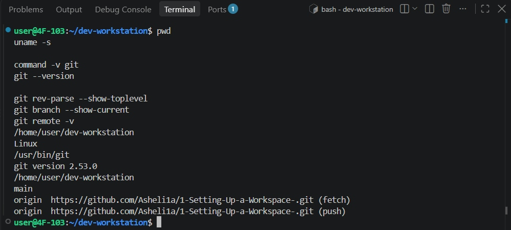
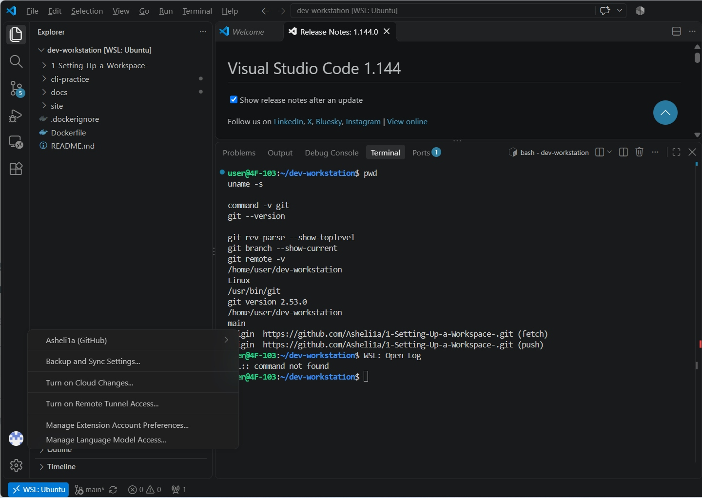
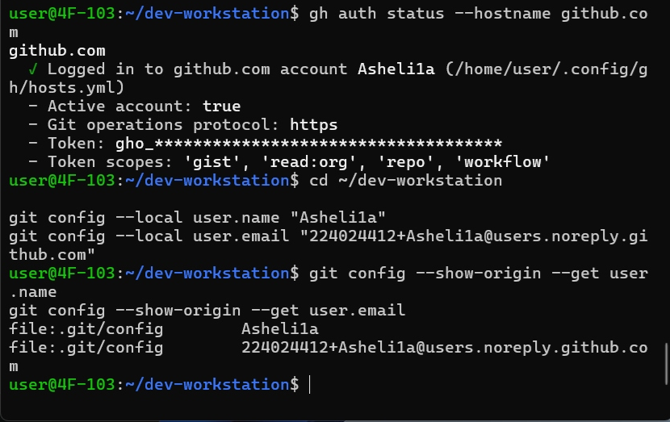
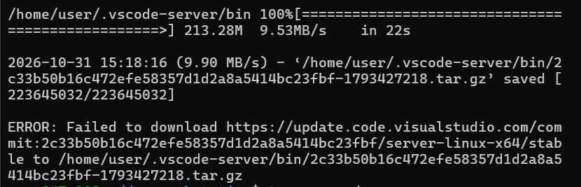

# 트러블슈팅

## 기록 원칙 및 현황

2026-10-31까지 제공된 실제 실행 결과와 캡처를 기준으로 정리했다. 오류·환경 설정 문제 6건 중 5건은 해결 결과를 확인했고, VS Code Server 설치 실패 1건은 원인 미확인으로 남겼다. 미해결 설치 메시지와 현재 WSL 개발 세션의 정상 동작은 구분한다.

| 번호 | 문제 | 상태 |
|---|---|---|
| 1 | Docker 소켓 접근 권한 오류 | 해결 완료 |
| 2 | GitHub HTTPS push 인증 실패 | 해결 완료 |
| 3 | GitHub 웹 업로드 후 push 거부 및 브랜치 분기 | 해결 완료 |
| 4 | VSCode의 Windows PowerShell에서 Ubuntu Git을 찾지 못함 | 해결 완료 |
| 5 | 공용 노트북의 VSCode에 타인 GitHub 계정이 로그인됨 | 본인 계정 전환 및 설정 확인 완료 |
| 6 | code 실행 중 VS Code Server 설치 실패 | 원인 미확인 / 현재 WSL 작업은 가능 |

### 증거 편집 원칙

- 호스트 프롬프트를 `$`로 통일하고 PowerShell은 `PS>`로 구분했다.
- 원본 Markdown에 잘못 들어간 이스케이프·공백 엔터티·로그 내부 링크는 원래 표기로 정리했다.
- 긴 로그의 일부를 생략한 곳은 발췌임을 명시했다. 재검증 명령의 순서와 출력 의미는 바꾸지 않았다.
- 캡처는 원본의 필요한 직사각형 영역만 잘랐다. 합성·텍스트 추가·출력 수정·확대 보정은 하지 않았다.
- 다른 사용자의 계정명은 기록하지 않았으며, 인증 토큰은 기존 마스킹 상태를 유지했다.
- 화면 증거의 의미를 설명한 문장과 실제 실행 로그를 구분한다.

## 1. Docker 소켓 접근 권한 오류

### 증상

```console
$ docker info
Client:
 Version: 29.9.2
...
Server:
permission denied while trying to connect to the docker API at unix:///var/run/docker.sock
```

위 출력은 오류와 관련된 부분만 발췌했다.

### 원인 분석 및 확인 범위

- 확인된 증상: Docker CLI 정보는 출력됐지만 Docker 소켓 접근에서 permission denied가 발생했다.
- 수행 기록: 기존 Ubuntu 세션에서 Docker Desktop의 WSL Integration 설정을 적용했지만 오류가 지속됐다.
- 해결 관찰: Ubuntu 터미널을 종료하고 다시 열자 엔진 연결과 hello-world 실행에 성공했다.
- 가설: 기존 세션에서 연동 상태가 정상 반영되지 않았을 가능성이 있다.
- 한계: 소켓 소유권·권한·그룹 전후를 수집하지 않았으므로 그룹 누락이나 내부 갱신 원인을 확정하지 않는다.

### 해결

터미널 종료 후 다시 실행하여 접속.

### 재검증

```console
$ docker --version
Docker version 29.9.2, build a82e528

$ docker info
Client:
 Version:    29.9.2
 Context:    default
 Debug Mode: false
 Plugins:
  agent: Docker AI Agent Runner (Docker Inc.)
    Version:  v1.152.0
    Path:     /usr/local/lib/docker/cli-plugins/docker-agent
  ai: Docker AI Agent - Ask Gordon (Docker Inc.)
    Version:  v1.33.0
    Path:     /usr/local/lib/docker/cli-plugins/docker-ai
  buildx: Docker Buildx (Docker Inc.)
    Version:  v0.38.1
    Path:     /usr/local/lib/docker/cli-plugins/docker-buildx
  compose: Docker Compose (Docker Inc.)
    Version:  v5.6.1
    Path:     /usr/local/lib/docker/cli-plugins/docker-compose
  debug: Get a shell into any image or container (Docker Inc.)
    Version:  0.49.0
    Path:     /usr/local/lib/docker/cli-plugins/docker-debug
  desktop: Docker Desktop commands (Docker Inc.)
    Version:  4.97.0
    Path:     /usr/local/lib/docker/cli-plugins/docker-desktop
  dhi: CLI for managing Docker Hardened Images (Docker Inc.)
    Version:  v0.0.9
    Path:     /usr/local/lib/docker/cli-plugins/docker-dhi
  extension: Manages Docker extensions (Docker Inc.)
    Version:  v0.2.32
    Path:     /usr/local/lib/docker/cli-plugins/docker-extension
  init: Creates Docker-related starter files for your project (Docker Inc.)
    Version:  v1.4.1
    Path:     /usr/local/lib/docker/cli-plugins/docker-init
  mcp: Docker MCP Plugin (Docker Inc.)
    Version:  v0.44.2
    Path:     /usr/local/lib/docker/cli-plugins/docker-mcp
  model: Docker Model Runner (Docker Inc.)
    Version:  v1.2.9
    Path:     /usr/local/lib/docker/cli-plugins/docker-model
  offload: Docker Offload (Docker Inc.)
    Version:  v0.7.21
    Path:     /usr/local/lib/docker/cli-plugins/docker-offload
  pass: Docker Pass Secrets Manager Plugin (beta) (Docker Inc.)
    Version:  v0.3.2
    Path:     /usr/local/lib/docker/cli-plugins/docker-pass
  sandbox: "docker sandbox" is deprecated, use Docker Sandboxes instead (Docker Inc.)
    Version:  v0.13.0
    Path:     /usr/local/lib/docker/cli-plugins/docker-sandbox
  scout: Docker Scout (Docker Inc.)
    Version:  v1.27.0
    Path:     /usr/local/lib/docker/cli-plugins/docker-scout
Server:
 Containers: 0
  Running: 0
  Paused: 0
  Stopped: 0
 Images: 0
 Server Version: 29.9.2
 Storage Driver: overlayfs
  driver-type: io.containerd.snapshotter.v1
 Logging Driver: local
 Cgroup Driver: cgroupfs
 Cgroup Version: 2
 Plugins:
  Volume: local
  Network: bridge host ipvlan macvlan null overlay
  Log: awslogs fluentd gcplogs gelf journald json-file local splunk syslog
 CDI spec directories:
  /etc/cdi
  /var/run/cdi
 Discovered Devices:
  cdi: docker.com/gpu=webgpu
 Swarm: inactive
 Runtimes: io.containerd.runc.v2 nvidia runc
 Default Runtime: runc
 Init Binary: docker-init
 containerd version: b7a25261e029d68978bbf290df0a62fc819b3c51
 runc version: v1.5.2-0-g29dd3dc2
 init version: de40ad0
 Security Options:
  seccomp
   Profile: builtin
  cgroupns
 Kernel Version: 6.18.54.1-microsoft-standard-WSL2
 Operating System: Docker Desktop
 OSType: linux
 Architecture: x86_64
 CPUs: 8
 Total Memory: 7.605GiB
 Name: docker-desktop
 ID: debdbb45-0f13-4be0-a40e-3410badffff0
 Docker Root Dir: /var/lib/docker
 Debug Mode: false
 HTTP Proxy: http.docker.internal:3128
 HTTPS Proxy: http.docker.internal:3128
 No Proxy: hubproxy.docker.internal
 Labels:
  com.docker.desktop.address=unix:///var/run/docker-cli.sock
 Experimental: false
 Insecure Registries:
  hubproxy.docker.internal:5555
  127.0.0.0/8
  ::1/128
 Live Restore Enabled: false
 Firewall Backend: iptables
```

```console
$ docker run hello-world
Unable to find image 'hello-world:latest' locally
latest: Pulling from library/hello-world
4f55086f7dd0: Pull complete
d5e71e642bf5: Download complete
Digest: sha256:c567b231f65614688711a75f31518a064258a51d442117a3e771a3a8fdba78ef
Status: Downloaded newer image for hello-world:latest
Hello from Docker!
This message shows that your installation appears to be working correctly.
To generate this message, Docker took the following steps:
 1. The Docker client contacted the Docker daemon.
 2. The Docker daemon pulled the "hello-world" image from the Docker Hub.
    (amd64)
 3. The Docker daemon created a new container from that image which runs the
    executable that produces the output you are currently reading.
 4. The Docker daemon streamed that output to the Docker client, which sent it
    to your terminal.
To try something more ambitious, you can run an Ubuntu container with:
 $ docker run -it ubuntu bash
Share images, automate workflows, and more with a free Docker ID:
 https://hub.docker.com/
For more examples and ideas, visit:
 https://docs.docker.com/get-started/
```

### 현재 상태

Docker 엔진 연결 및 hello-world 실행 성공을 확인했다.

## 2. GitHub HTTPS push 인증 실패

### 증상

```console
$ git push -u origin main
remote: Invalid username or token. Password authentication is not supported for Git operations.
fatal: Authentication failed for 'https://github.com/Asheli1a/1-Setting-Up-a-Workspace-.git/'
```

### 원인

GitHub HTTPS Git 작업에서는 계정 비밀번호 인증을 사용할 수 없다.

Git 사용자 이름·이메일 설정과 원격 저장소 인증은 별개다.

### 해결

GitHub CLI로 브라우저 인증을 완료하고 Git 인증 연동을 설정했다.

```bash
gh auth login --hostname github.com --git-protocol https --web
gh auth setup-git
```

### 재검증

```console
$ gh auth setup-git

$ gh auth status
github.com
  ✓ Logged in to github.com account Asheli1a (/home/user/.config/gh/hosts.yml)
  - Active account: true
  - Git operations protocol: https
  - Token: gho_************************************
  - Token scopes: 'gist', 'read:org', 'repo', 'workflow'

$ git push -u origin main
Enumerating objects: 7, done.
Counting objects: 100% (7/7), done.
Delta compression using up to 8 threads
Compressing objects: 100% (6/6), done.
Writing objects: 100% (7/7), 5.50 KiB | 5.50 MiB/s, done.
Total 7 (delta 0), reused 0 (delta 0), pack-reused 0 (from 0)
To https://github.com/Asheli1a/1-Setting-Up-a-Workspace-.git
 * [new branch]      main -> main
branch 'main' set up to track 'origin/main'.
```

### 현재 상태

해결 완료. GitHub CLI 인증 이후 첫 push와 main 원격 추적 설정에 성공했다.

### 보안 및 구분

Git 작성자 정보, GitHub CLI 인증, VSCode 계정 로그인은 서로 다른 항목이다. 인증 토큰·일회용 코드는 공개하지 않는다. 이후 본인 계정 및 작성자 설정의 최종 확인은 사례 5에 기록했다.

## 3. GitHub 웹 업로드 후 push 거부 및 브랜치 분기

### 증상

바인드 마운트 실습 중 브라우저 접속 증거 이미지를 윈도우상의 GitHub 웹에서 업로드한 뒤, 로컬에서 바인드 마운트 실습 문서를 커밋하고 push했다.
그러나 원격 변경을 먼저 가져와야 한다는 메시지와 함께 거부됐다.

```console
$ git commit -m "docs: record verified bind mount content updates"
[main f3cf6ff] docs: record verified bind mount content updates
 3 files changed, 250 insertions(+), 3 deletions(-)
 create mode 100644 cli-practice/bind-site/index.html

$ git push origin main
 ! [rejected]        main -> main (fetch first)
error: failed to push some refs to 'https://github.com/Asheli1a/1-Setting-Up-a-Workspace-.git'
```

이후 `git pull`을 실행했지만, 분기된 브랜치의 통합 방식을 지정해야 한다는 메시지와 함께 중단됐다.

```console
$ git pull
From https://github.com/Asheli1a/1-Setting-Up-a-Workspace-
   10c69f3..c60296f  main       -> origin/main
hint: You have divergent branches and need to specify how to reconcile them.
fatal: Need to specify how to reconcile divergent branches.
```

출력은 오류와 관련된 부분만 발췌했다.

### 원인 가설

- GitHub 웹에서 이미지를 업로드하면서 원격 main에 새 커밋이 생겼다.
- 로컬에서도 별도의 문서 커밋을 만들어 양쪽 이력이 분기됐을 가능성이 있다.
- 처음에는 이미지 파일 충돌을 의심했지만, 실제 파일 충돌인지 이력 통합 문제인지 구분할 필요가 있었다.

### 확인

`git pull`은 원격 변경을 가져왔지만, merge 또는 rebase 방식이 지정되지 않아 통합을 수행하지 않았다.

이후 확인한 커밋 그래프에서는 공통 커밋 이후 로컬 문서 커밋과 원격 웹 업로드 커밋이 각각 존재했다.

```console
$ git log --oneline --graph --decorate -8
*   3576cc1 (HEAD -> main) Merge remote-tracking branch 'origin/main'
|\
| * c60296f (origin/main, origin/HEAD) Add files via upload
| * a9640de Add files via upload
| * 5d48f46 Add files via upload
* | f3cf6ff docs: record verified bind mount content updates
|/
* 10c69f3 _
* e0f55a9 docs: complete custom web image and dual-port verification
* b75be04 docs: record Docker operations and container lifecycle experiments
```

위 그래프는 병합 후, 최종 push 전에 확인한 결과다.

### 해결

로컬 문서 커밋과 원격 이미지 커밋을 모두 보존하기 위해 merge 방식으로 통합했다.

```console
$ git merge --no-edit origin/main
Merge made by the 'ort' strategy.
 docs/images/bind-after.png  | Bin 0 -> 35287 bytes
 docs/images/bind-before.png | Bin 0 -> 22995 bytes
 docs/images/web-8080.png    | Bin 0 -> 23626 bytes
 docs/images/web-8081.png    | Bin 0 -> 24641 bytes
 4 files changed, 0 insertions(+), 0 deletions(-)
 create mode 100644 docs/images/bind-after.png
 create mode 100644 docs/images/bind-before.png
 create mode 100644 docs/images/web-8081.png
```

실제 파일 충돌 없이 자동 병합됐으며, 병합 커밋 `3576cc1`이 생성됐다.
강제 push나 기존 커밋 삭제는 사용하지 않았다.

### 재검증

원격에서 업로드한 이미지가 로컬에도 반영됐는지 확인했다.

```console
$ ls -l docs/images/
total 112
-rw-r--r-- 1 user user 35287 Oct 30 19:14 bind-after.png
-rw-r--r-- 1 user user 22995 Oct 30 19:14 bind-before.png
-rw-r--r-- 1 user user 23626 Oct 30 19:14 web-8080.png
-rw-r--r-- 1 user user 24641 Oct 30 19:14 web-8081.png
```

병합 결과를 GitHub에 push했다.

```console
$ git push origin main
To https://github.com/Asheli1a/1-Setting-Up-a-Workspace-.git
   c60296f..3576cc1  main -> main
```

push 출력은 핵심 부분만 발췌했다.

### 현재 상태

해결 완료.
로컬 문서 변경과 GitHub 웹 업로드 이미지를 통합하고, 병합 결과를 원격 main에 반영했다.

### 배운 점 및 재발 방지

- 이번 문제는 이미지 내용 충돌이 아니라, 원격과 로컬에서 각각 커밋하면서 발생한 브랜치 분기였다.
- push 거부와 실제 파일 병합 충돌을 구분해야 한다.
- `git pull`에서 통합 방식 지정 오류가 발생한 경우, 아직 파일 충돌이 발생했다고 단정할 수 없다.
- 앞으로는 캡처도 로컬의 docs/images에 저장하고, 관련 문서와 함께 커밋하는 방식으로 작업 흐름을 통일한다.
- GitHub 웹에서 직접 변경했다면 로컬 작업을 이어가기 전에 원격 변경을 확인하고 동기화한다.

## 4. VSCode의 PowerShell에서 Git 명령을 찾지 못함

### 증상

Ubuntu의 프로젝트 경로를 열었지만 VSCode 통합 터미널은 Windows PowerShell이었다. Ubuntu 터미널에서는 정상 동작하던 Git을 이 창에서는 찾지 못했다.

아래는 오류 로그의 핵심 부분만 발췌한 것이다.

```console
PS Microsoft.PowerShell.Core\FileSystem::\wsl.localhost\Ubuntu\home\user\dev-workstation> git rev-parse --show-toplevel
git : 'git' 용어가 cmdlet, 함수, 스크립트 파일 또는 실행할 수 있는 프로그램 이름으로 인식되지 않습니다.
```

`git branch --show-current`, `git remote -v`도 같은 종류의 오류가 발생했다.

### 원인 분석

- 폴더 위치는 WSL Ubuntu였지만 명령을 해석한 프로세스는 Windows PowerShell이었다.
- Ubuntu에 설치된 Git이 Windows PowerShell에서도 자동으로 같은 명령으로 실행된다고 볼 수는 없다.
- 당시 Windows의 PATH에 Git이 없다는 오류가 확인됐지만, Windows 전체에 Git이 전혀 설치되지 않았다고까지 단정하지 않는다.
- 과제의 실행 환경을 WSL로 통일하는 것이 이번 해결 방향이었다.

### 해결

1. WSL 확장을 통한 Ubuntu 연결 상태를 확인했다.
2. 프로젝트가 `dev-workstation [WSL: Ubuntu]`로 열린 상태에서 새 Bash 통합 터미널을 사용했다.
3. 처음 연결 화면에 Restricted Mode가 표시됐고, 이후 화면에서는 해당 표시가 사라졌다. 신뢰 설정 변경의 클릭 과정 자체는 별도 로그가 없으므로 아래 Git 성공의 단독 원인으로 단정하지 않는다.
4. Git 재설치·저장소 재생성 없이 Ubuntu Git과 기존 저장소를 조회했다.

### 재검증

VSCode 통합 터미널에서 확인한 명령과 출력이다. 원본에서 여러 줄로 입력한 명령을 명령별 출력과 함께 정리했다.

```console
$ pwd
/home/user/dev-workstation

$ uname -s
Linux

$ command -v git
/usr/bin/git

$ git --version
git version 2.53.0

$ git rev-parse --show-toplevel
/home/user/dev-workstation

$ git branch --show-current
main

$ git remote -v
origin  https://github.com/Asheli1a/1-Setting-Up-a-Workspace-.git (fetch)
origin  https://github.com/Asheli1a/1-Setting-Up-a-Workspace-.git (push)
```



편집 내역: `001.jpg`의 통합 터미널 영역만 잘랐다. WSL 창 연결 표시는 사례 5의 넓은 캡처에서도 확인할 수 있다.

### 현재 상태

해결 완료. WSL 통합 Bash에서 Ubuntu Git과 기존 프로젝트 조회가 정상 동작했다. 이 사실은 별도로 발생한 `code .` 설치 실패의 원인까지 해결했다는 뜻은 아니다.

### 재발 방지

- WSL 파일 경로를 열었다는 사실과 실행 환경이 WSL이라는 사실을 구분한다.
- VSCode의 WSL 연결 표시, 통합 터미널 종류, `uname -s`, Git 실행 경로를 함께 확인한다.
- 현재 문제의 해결을 위해 Windows Git을 추가 설치하거나 저장소를 다시 clone할 필요는 없었다.

## 5. 공용 노트북의 VSCode에 타인 GitHub 계정이 로그인됨

### 증상 및 확인

공용 실습 노트북의 VSCode 계정 메뉴를 확인하던 중 본인이 아닌 사용자의 GitHub 계정이 로그인되어 있음을 발견했다. 기존 사용자의 계정명은 공개하지 않는다. 변경 전 계정 정보는 캡처로 제출하지 않았고, 이 부분은 실제 수행자의 관찰 기록이다.

### 원인 분석

공용 장비에 기존 로그인 세션이 남아 있었다. 프로젝트의 Git 원격 URL이나 커밋 작성자 이름이 본인 계정과 같다고 해서 VSCode의 로그인 계정도 같다고 판단해서는 안 됐다.

다음 항목을 별도로 확인했다.

| 항목 | 확인 대상 |
|---|---|
| Git 작성자 | user.name / user.email |
| 기본 브랜치 | init.defaultBranch / 현재 브랜치 |
| Git 원격 | origin URL |
| GitHub CLI 인증 | gh auth status |
| VSCode 계정 | 계정 메뉴의 GitHub 로그인 |

### 해결

- 기존 VSCode 계정을 로그아웃하고 본인 GitHub 계정으로 다시 로그인했다.
- 계정 메뉴에서 `Asheli1a (GitHub)` 표시를 확인했다.
- GitHub CLI도 본인 계정이 활성 상태인지 별도로 조회했다.
- 현재 프로젝트의 Git 작성자 정보는 저장소별 설정으로 명시했다.
- 저장소별 작성자 설정은 인증 계정을 전환하는 기능이 아니라 커밋 작성자 정보 설정이다.

### 재검증 1: VSCode 계정



편집 내역: `003.jpg`에서 오른쪽 Chat 영역만 제외했다. 계정 메뉴, 프로젝트, WSL 표시와 실제 터미널 출력은 원본 그대로다. 이전 계정 로그아웃 과정은 사용자 수행 기록이며 이 화면은 전환 후 결과다.

### 재검증 2: GitHub CLI

외부 Ubuntu 터미널과 VSCode의 WSL 통합 터미널에서 같은 명령을 실행했다. 두 환경 모두 본인 계정이 활성 상태였다.

아래는 계정과 인증 상태에 관련된 부분만 발췌한 것이다. 토큰·권한 범위 행은 중복을 줄이기 위해 생략했으며, 새 토큰을 출력하거나 재발급한 것은 아니다.

```console
$ gh auth status --hostname github.com
github.com
  ✓ Logged in to github.com account Asheli1a (/home/user/.config/gh/hosts.yml)
  - Active account: true
  - Git operations protocol: https
```

### 재검증 3: 저장소별 Git 작성자 정보

```console
$ cd ~/dev-workstation

$ git config --local user.name "Asheli1a"
$ git config --local user.email "224024412+Asheli1a@users.noreply.github.com"

$ git config --show-origin --get user.name
file:.git/config        Asheli1a

$ git config --show-origin --get user.email
file:.git/config        224024412+Asheli1a@users.noreply.github.com
```

열 간격과 화면 줄바꿈은 가독성을 위해 정리했다.



편집 내역: `004.jpg`의 오른쪽 터미널 하단만 잘랐다. 상단에는 CLI 인증, 하단에는 local 설정과 `.git/config` 출처가 표시된다. 원본의 긴 줄 자동 줄바꿈·창 가장자리의 일부 잘림은 수정하지 않았으므로 이메일 전체는 위 텍스트 로그와 함께 확인한다.

초기 전역 설정 확인 결과와 최종 저장소별 설정은 다음과 같이 구분한다.

| 항목 | 초기 확인 | 최종 확인 |
|---|---|---|
| user.name | /home/user/.gitconfig → Asheli1a | .git/config → Asheli1a |
| user.email | /home/user/.gitconfig → 본인 noreply 주소 | .git/config → 동일한 noreply 주소 |
| init.defaultBranch | /home/user/.gitconfig → main | 이번 local 변경 대상 아님 |
| 현재 브랜치 | main | main |

초기 설정 출처와 전체 설정 조회는 앞선 실제 실행 결과로 확인했다. local 설정 후 `git config --list` 전체를 다시 수집한 로그는 아직 제공되지 않아 새 출력처럼 작성하지 않았다.

### 현재 상태

본인 계정 전환과 CLI 인증·저장소별 작성자 설정 확인 완료. 이후 이 설정으로 새 커밋을 만들고 작성자 메타데이터를 확인한 별도 로그는 아직 수집하지 않았다.

### 공용 장비 재발 방지 및 남은 보안 점검

- 작업 시작 시 VSCode 계정과 CLI 활성 계정을 각각 확인한다.
- 실제 토큰·인증 코드·개인키 및 타인 계정 정보는 문서나 캡처에 넣지 않는다.
- `.git/config`는 이번 설정의 확인 대상이지만 인증정보를 포함할 수 있는 설정 파일 전체를 무분별하게 공개하지 않는다.
- 개인 설정 동기화는 과제의 필수 조건이 아니며 실제 사용·해제 상태는 별도로 확인한다.
- 장비 반납 시 본인의 VSCode·CLI·브라우저 인증을 장비 정책에 따라 정리한다. 아직 로그아웃·토큰 폐기를 실행했다는 뜻은 아니다.
- 다른 사용자의 인증정보나 설정을 일괄 삭제하지 않는다.

## 6. code 실행 중 VS Code Server 설치 실패

### 증상

외부 Ubuntu 터미널에서 `code .`을 실행했을 때 다운로드가 100%에 도달하고 저장 완료를 보고했으나, 실행 경로는 최종적으로 실패 메시지를 출력했다.

아래는 제공된 원본 로그의 핵심 부분이다. HTTP 리다이렉트·진행 막대는 생략했다.

```console
$ code .
Installing VS Code Server for Linux x64 (2c33b50b16c472efe58357d1d2a8a5414bc23fbf)
Downloading: 100%
Failed
[HTTP 요청·리다이렉트·진행 출력 생략]
2026-10-31 15:18:16 (9.90 MB/s) - ‘/home/user/.vscode-server/bin/2c33b50b16c472efe58357d1d2a8a5414bc23fbf-1793427218.tar.gz’ saved [223645032/223645032]

ERROR: Failed to download https://update.code.visualstudio.com/commit:2c33b50b16c472efe58357d1d2a8a5414bc23fbf/server-linux-x64/stable to /home/user/.vscode-server/bin/2c33b50b16c472efe58357d1d2a8a5414bc23fbf-1793427218.tar.gz
```



편집 내역: `004.jpg`의 오른쪽 터미널 상단 중 저장 완료·오류 메시지 부분만 잘랐다. 이 캡처는 과거 실패 기록이며 현재 세션 실패를 뜻하지 않는다.

### 확인한 실행 경로

```console
$ type -a code
code is /mnt/c/Users/User/AppData/Local/Programs/Microsoft VS Code/bin/code

$ command -v code
/mnt/c/Users/User/AppData/Local/Programs/Microsoft VS Code/bin/code
```

Windows에 설치된 VSCode의 실행 스크립트를 호출하고 있었다. 이 경로만으로 잘못된 설치라고 판단하지 않았다.

### 진단 시도와 안내 정정

- 명령 팔레트에서 `WSL: Open Log`를 검색했지만 해당 명령은 목록에 없었다.
- 이를 Bash에 입력했을 때는 `WSL: command not found`가 발생했다. 이는 VSCode 명령명을 셸 명령으로 입력한 별도 입력 오류이지 WSL 연결 실패 증거가 아니다.
- 해당 메뉴 명칭을 현재 환경에서 사용할 수 있다는 초기 안내는 맞지 않았다.
- 개발자 로그 또는 Output 채널의 추가 자료는 아직 수집하지 않았다.

### 현재 확인된 사실

| 항목 | 결과 |
|---|---|
| 다운로드 도구의 보고 | 223,645,032바이트 저장 완료 |
| 실행 스크립트의 최종 보고 | 설치 경로에서 실패 메시지 출력 |
| 압축 파일 무결성·해제·서버 기동 | 해당 시도의 세부 검증 없음 |
| 현재 열린 VSCode | WSL: Ubuntu 표시 |
| 현재 WSL 통합 터미널 | Linux·Ubuntu Git·저장소 조회 정상 |
| 원인 | 미확인 |

### 대응 및 현재 상태

원인 미확인으로 보류했다. 현재 동작하는 WSL 창을 사용해 과제를 이어갔으며, 서버 폴더 전체 삭제·Git 재설치·저장소 재생성은 수행했다고 기록하지 않는다.

파일 저장 완료가 설치 성공을 뜻한다고 보거나, 최종 실패 문구만으로 네트워크 단절·압축 손상·권한 문제라고 단정하지 않는다. 현재 동작 중인 WSL 세션과 실패한 설치 시도가 어떤 경로로 연결되는지도 확인하지 못했다.

현재 개발 작업은 가능하지만, 외부 터미널에서 `code .`을 다시 실행하는 경로가 복구됐다는 재검증은 없다. 재현성·실행 진입 경로에 남은 제한 사항으로 공개한다.

### 재발 시 추가 수집 계획 — 미수행

- 실패 시점의 VSCode/WSL 확장 로그와 실제 호출 경로
- 해당 압축 파일의 존재·크기·무결성 및 설치 단계별 오류
- 저장 공간·권한·다운로드 도구 반환 상태
- VSCode 버전·커밋과 해당 시도에서 사용한 서버 버전의 관계

위 항목은 가능한 진단 계획이며 확인된 원인이나 실행 완료 항목이 아니다.

## 7. 최종 정리

- 사례 1~3: 기존 Docker·HTTPS 인증·Git 이력 문제의 해결 기록을 유지했다.
- 사례 4: Windows PowerShell과 Ubuntu Bash의 실행 환경 차이를 확인하고 해결했다.
- 사례 5: 공용 장비의 계정 혼동을 바로잡고, 인증과 커밋 작성자 설정을 따로 검증했다.
- 사례 6: 설치 실패는 미해결로 공개하되 현재 세션 정상 동작과 구분했다.
- 캡처의 일부 영역을 자른 것은 가독성을 위한 편집이며 출력 내용이나 결과를 바꾼 것은 아니다.

[프로젝트 README](../README.md)
