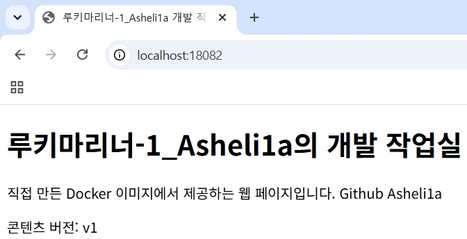

# Docker Compose 단일 서비스 실행 및 운영 검증

## 1. 수행 범위와 현재 상태

- 수행 일자: 2026-11-02
- 실행 위치: WSL Ubuntu의 `~/dev-workstation`
- 실행 환경: 기존 Docker Desktop WSL 연동
- Docker Engine: 29.9.2
- Docker Compose: v5.6.1
- 단일 서비스 빌드·실행·HTTP·브라우저·로그 확인 완료
- up·ps·logs·down 및 종료 후 상태 확인 완료
- 이 문서는 단일 서비스 기록이다. 멀티 컨테이너는 [08 문서](08-compose-multi.md), 환경 변수는 [09 문서](09-compose-env.md)에 별도로 기록한다. SSH 인증·push는 [10 문서](10-github-ssh.md)의 별도 실습으로 기록했다.

아래 console 블록은 제공된 실제 명령과 출력이다. 프롬프트를 `$`로 정리하고 명령별 출력을 대응시켰다. 긴 초기 환경 출력은 필요한 부분만 발췌했다고 표시했으며, 결과를 새로 만들어 넣지 않았다.

작업 시작 시 조회한 HEAD는 [7b36293](https://github.com/Asheli1a/1-Setting-Up-a-Workspace-/commit/7b362930f35674237b31e270eee979d0fd4ac14a)이었다. 실행에 사용한 웹 소스와 Compose 설정에는 이후 작업 디렉터리의 미커밋 변경이 포함되어 있으므로, 해당 HEAD만을 실행 입력 전체의 확정 커밋으로 보지 않는다. 설정과 실제 응답은 아래 기록을 기준으로 한다.

## 2. Compose를 사용하는 의미

Dockerfile은 이미지를 어떻게 만들지 정의하고, Compose 파일은 그 이미지를 어떤 서비스 구성으로 실행할지 정의한다. 기존 Dockerfile을 유지하면서 빌드 위치·이미지 태그·포트 연결을 YAML에 기록했다.

이 실습의 목적은 긴 실행 옵션을 외워 입력하는 방식에서, 저장된 실행 설정으로 같은 서비스를 반복 실행하고 상태·로그·종료를 관리하는 방식으로 확장하는 것이다. Compose가 Dockerfile을 대체하는 것은 아니다.

| 선택 항목 | 이번 결과 |
|---|---|
| Compose 단일 서비스 | 완료 — 빌드·실행·HTTP·브라우저 확인 |
| Compose 운영 명령 | 완료 — up·ps·logs·down 및 종료 후 목록 확인 |
| 멀티 컨테이너 통신 | 별도 실습 완료 — [08 문서](08-compose-multi.md) |
| 환경 변수 동작 변경 | 별도 실습 완료 — [09 문서](09-compose-env.md) |
| GitHub SSH 인증 | 별도 실습 완료 — [10 문서](10-github-ssh.md) |

공식 설명: [What is Docker Compose?](https://docs.docker.com/get-started/docker-concepts/the-basics/what-is-docker-compose/)

## 3. 실제 실행 구성

| 항목 | 적용값 |
|---|---|
| Compose 파일 | 저장소 루트의 `docker-compose.yml` |
| 프로젝트 이름 | `workspace-bonus-single` |
| 서비스 이름 | `web` |
| 빌드 컨텍스트 | 프로젝트 루트 `.` |
| Dockerfile | 기존 루트 Dockerfile |
| 이미지 태그 | `workspace-web:compose-single` |
| 실제 표시 이미지 ID | `a46d30a28908` |
| 컨테이너 이름 | `workspace-bonus-single-web-1` |
| 플랫폼 | `linux/amd64` |
| 포트 매핑 | `127.0.0.1:18082 → 80/tcp` |
| 웹 소스 | `site/index.html` |
| 콘텐츠 버전 | `v1` |
| 스토리지 | 별도 마운트·볼륨 없음 |

기존 필수 실습과 프로젝트 이름·이미지 태그·호스트 포트를 구분했다. 컨테이너 이름은 고정하지 않고 Compose가 생성한 이름을 실제 출력으로 확인했다. 기존 `workspace-data` 볼륨을 이번 서비스에 연결하지 않았다.

## 4. 실행 전 확인

```console
$ cd ~/dev-workstation
$ pwd
/home/user/dev-workstation

$ git status
On branch main
Your branch is up to date with 'origin/main'.

Untracked files:
  (use "git add <file>..." to include in what will be committed)
        1-Setting-Up-a-Workspace-/
        cli-practice/basic-ops/
        cli-practice/permissions/

nothing added to commit but untracked files present (use "git add" to track)

$ git log -1 --oneline
7b36293 (HEAD -> main, origin/main, origin/HEAD) docs: redact personal names and update privacy guidance

$ docker info
[Client/Server의 주요 버전·환경 부분만 발췌]
Client:
 Version:    29.9.2
 Context:    default
Server:
 Server Version: 29.9.2
 Kernel Version: 6.18.54.1-microsoft-standard-WSL2
 Operating System: Docker Desktop
 OSType: linux
 Architecture: x86_64

$ docker compose version
Docker Compose version v5.6.1
```

Docker Server 정보를 확인해 엔진 연결과 Compose 사용 가능 상태를 점검했다. Docker info의 자원·컨테이너 수는 조회 시점의 값이므로 이후 ps의 상태와 동일 시점이라고 간주하지 않는다.

### 기존 구성·포트 확인

```console
$ docker compose ls -a
NAME                STATUS              CONFIG FILES

$ docker ps -a \
  --filter label=com.docker.compose.project=workspace-bonus-single
CONTAINER ID   IMAGE     COMMAND   CREATED   STATUS    PORTS     NAMES

$ docker image ls workspace-web:compose-single
                                                                                                    i Info →   U  In Use
IMAGE   ID             DISK USAGE   CONTENT SIZE   EXTRA

$ ss -ltn '( sport = :18082 )'
State          Recv-Q          Send-Q                   Local Address:Port                   Peer Address:Port

$ for file in compose.yaml compose.yml docker-compose.yaml docker-compose.yml
> do
>   if [ -e "$file" ]; then
>     ls -l "$file"
>   fi
> done
```

파일 확인 반복문은 출력이 없었다. 조회 당시 동일 Compose 프로젝트·대상 이미지·기본 Compose 파일이 표시되지 않았고, ss에서도 해당 리스닝 항목이 표시되지 않았다. ss만으로 Windows·Docker Desktop 전체의 포트 예약까지 확정한 것은 아니며, 이후 실제 실행 성공으로 이번 포트 연결을 확인했다.

## 5. Compose 파일과 설정 해석

### 파일 내용

```console
$ nano docker-compose.yml

$ cat docker-compose.yml
services:
  web:
    build:
      context: .
      dockerfile: Dockerfile
    image: workspace-web:compose-single
    ports:
      - "127.0.0.1:18082:80"
```

| 설정 | 목적 |
|---|---|
| `services.web` | web 서비스 정의 |
| `build.context: .` | 프로젝트 루트를 빌드 컨텍스트로 지정 |
| `dockerfile: Dockerfile` | 기존 커스텀 이미지 정의 재사용 |
| `image` | 선택 실습용 이미지 태그 지정 |
| `ports` | 로컬 호스트 18082를 컨테이너 80에 연결 |

이번 구성은 이미지의 COPY로 포함한 HTML을 제공하며 바인드 마운트 구성은 아니다.

### config 결과

```console
$ docker compose -p workspace-bonus-single \
  -f docker-compose.yml config
name: workspace-bonus-single
services:
  web:
    image: workspace-web:compose-single
    networks:
      default: null
    build:
      context: /home/user/dev-workstation
      dockerfile: Dockerfile
    ports:
      - mode: ingress
        host_ip: 127.0.0.1
        target: 80
        published: "18082"
        protocol: tcp
networks:
  default:
    name: workspace-bonus-single_default
```

YAML이 정상 해석됐고, 빌드 경로·이미지·포트와 프로젝트 기본 네트워크 이름을 확인했다. config 결과만으로 접속 성공을 판정하지 않고 실제 실행과 HTTP를 별도로 확인했다.

## 6. 이미지 빌드와 서비스 실행

다음은 실제 수집한 빌드·실행 결과다.

```console
$ docker compose -p workspace-bonus-single \
  -f docker-compose.yml up -d --build web
[+] Building 1.7s (9/9) FINISHED
 => [internal] load local bake definitions                                                                         0.0s
 => => reading from stdin 524B                                                                                     0.0s
 => [internal] load build definition from Dockerfile                                                               0.0s
 => => transferring dockerfile: 164B                                                                               0.0s
 => [internal] load metadata for docker.io/library/nginx:alpine                                                    1.0s
 => [internal] load .dockerignore                                                                                  0.0s
 => => transferring context: 76B                                                                                   0.0s
 => [internal] load build context                                                                                  0.0s
 => => transferring context: 500B                                                                                  0.0s
 => CACHED [1/2] FROM docker.io/library/nginx:alpine@sha256:785835ea65db4bba6f021acc0f3be91b0fef76a53fe41f8588c66  0.0s
 => => resolve docker.io/library/nginx:alpine@sha256:785835ea65db4bba6f021acc0f3be91b0fef76a53fe41f8588c6698d2aed  0.0s
 => [2/2] COPY site/ /usr/share/nginx/html/                                                                        0.0s
 => exporting to image                                                                                             0.3s
 => => exporting layers                                                                                                           0.1s
 => => exporting manifest sha256:ed4b099305e0a72dcf2639d8d679c759558988cd387136c4226bd8db139cca2d                  0.0s
 => => exporting config sha256:913c5debae49cc095227de3763463bedcec73781e8ecfe9837ab615a9e6c6880                    0.0s
 => => exporting attestation manifest sha256:c52166dcd7c1c7c338d553d8796825f2ff8de97c95eaa02e9fafa0a29678de21      0.0s
 => => exporting manifest list sha256:a46d30a28908c84c1ca3f0dc6e71129fca7df3266900d9cfdb32e94c109f130c             0.0s
 => => naming to docker.io/library/workspace-web:compose-single                                                    0.0s
 => => unpacking to docker.io/library/workspace-web:compose-single                                                 0.0s
 => resolving provenance for metadata file                                                                         0.0s
[+] up 2/2
 ✔ Image workspace-web:compose-single     Built                                                                     1.9s
 ✔ Container workspace-bonus-single-web-1 Started                                                                   0.7s
```

- 베이스 레이어는 기존 캐시를 사용했다.
- COPY 단계는 실제 실행됐다.
- 이미지는 `workspace-web:compose-single`로 빌드됐고 서비스 컨테이너가 시작됐다.
- `--build`를 사용했지만 캐시 없는 빌드로 기록하지 않는다.
- 이 로그의 베이스 digest 표시는 터미널에서 잘린 값이므로 완전한 고정값으로 복사하지 않는다.

## 7. 상태 및 이미지 확인

```console
$ docker compose -p workspace-bonus-single \
  -f docker-compose.yml ps
NAME                           IMAGE                          COMMAND                  SERVICE   CREATED         STATUS         PORTS
workspace-bonus-single-web-1   workspace-web:compose-single   "/docker-entrypoint.…"   web       7 seconds ago   Up 6 seconds   127.0.0.1:18082->80/tcp

$ docker compose -p workspace-bonus-single \
  -f docker-compose.yml images
CONTAINER                      REPOSITORY          TAG                 PLATFORM            IMAGE ID            SIZE                CREATED
workspace-bonus-single-web-1   workspace-web       compose-single      linux/amd64         a46d30a28908        93.6MB              7 seconds ago
```

web 서비스가 실행 상태이고 포트 연결이 계획과 일치했다. 이 출력에는 컨테이너 이름은 있지만 컨테이너 ID는 없으므로 임의의 ID를 추가하지 않았다. 상태가 Up이라는 사실과 HTTP 성공은 별도로 확인했다.

## 8. HTTP·브라우저·서버 로그 확인

### HTTP 응답

```console
$ curl --max-time 5 -i http://localhost:18082
HTTP/1.1 200 OK
Server: nginx/1.31.8
Date: Mon, 02 Nov 2026 07:17:29 GMT
Content-Type: text/html
Content-Length: 428
Last-Modified: Mon, 02 Nov 2026 07:16:58 GMT
Connection: keep-alive
ETag: "6ae838ea-1ac"
Accept-Ranges: bytes

<!doctype html>
<html lang="ko">
<head>
  <meta charset="utf-8">
  <meta name="viewport" content="width=device-width, initial-scale=1">
  <title>루키마리너-1_Asheli1a 개발 작업실</title>
</head>
<body>
  <h1>루키마리너-1_Asheli1a의 개발 작업실</h1>
  <p>직접 만든 Docker 이미지에서 제공하는 웹 페이지입니다. Github Asheli1a</p>
  <p id="version">콘텐츠 버전: v1</p>
</body>
</html>
```

HTTP 응답의 Date는 2026-11-02 07:17:29 GMT로, KST 기준 16:17:29이다. 이는 해당 HTTP 응답 시각이며 전체 실습 시작·종료 시각으로 확대 해석하지 않는다.

### Windows 브라우저



주소창에 localhost:18082가 표시되고 개발 작업실 페이지와 콘텐츠 버전 v1이 함께 보인다. 제공된 JPG를 같은 크기의 PNG로 저장했으며, 화면 내용이나 출력 문구는 편집하지 않았다.

### 서버 로그

```console
$ docker compose -p workspace-bonus-single \
  -f docker-compose.yml logs --tail 30 web
web-1  | /docker-entrypoint.sh: /docker-entrypoint.d/ is not empty, will attempt to perform configuration
web-1  | /docker-entrypoint.sh: Looking for shell scripts in /docker-entrypoint.d/
web-1  | /docker-entrypoint.sh: Launching /docker-entrypoint.d/10-listen-on-ipv6-by-default.sh
web-1  | 10-listen-on-ipv6-by-default.sh: info: Getting the checksum of /etc/nginx/conf.d/default.conf
web-1  | 10-listen-on-ipv6-by-default.sh: info: Enabled listen on IPv6 in /etc/nginx/conf.d/default.conf
web-1  | /docker-entrypoint.sh: Sourcing /docker-entrypoint.d/15-local-resolvers.envsh
web-1  | /docker-entrypoint.sh: Launching /docker-entrypoint.d/20-envsubst-on-templates.sh
web-1  | /docker-entrypoint.sh: Launching /docker-entrypoint.d/30-tune-worker-processes.sh
web-1  | /docker-entrypoint.sh: Configuration complete; ready for start up
web-1  | 2026/11/02 07:17:16 [notice] 1#1: using the "epoll" event method
web-1  | 2026/11/02 07:17:16 [notice] 1#1: nginx/1.31.8
web-1  | 2026/11/02 07:17:16 [notice] 1#1: built by gcc 15.2.0 (Alpine 15.2.0)
web-1  | 2026/11/02 07:17:16 [notice] 1#1: OS: Linux 6.18.54.1-microsoft-standard-WSL2
web-1  | 2026/11/02 07:17:16 [notice] 1#1: getrlimit(RLIMIT_NOFILE): 1048576:1048576
web-1  | 2026/11/02 07:17:16 [notice] 1#1: start worker processes
web-1  | 2026/11/02 07:17:16 [notice] 1#1: start worker process 30
web-1  | 2026/11/02 07:17:16 [notice] 1#1: start worker process 31
web-1  | 2026/11/02 07:17:16 [notice] 1#1: start worker process 32
web-1  | 2026/11/02 07:17:16 [notice] 1#1: start worker process 33
web-1  | 2026/11/02 07:17:16 [notice] 1#1: start worker process 34
web-1  | 2026/11/02 07:17:16 [notice] 1#1: start worker process 35
web-1  | 2026/11/02 07:17:16 [notice] 1#1: start worker process 36
web-1  | 2026/11/02 07:17:16 [notice] 1#1: start worker process 37
web-1  | 172.18.0.1 - - [02/Nov/2026:07:17:29 +0000] "GET / HTTP/1.1" 200 428 "-" "curl/8.18.0" "-"
```

HTTP 응답의 시각·상태·크기와 로그의 GET / 200 428이 대응한다. 웹 서버의 시작 기록과 요청 처리 결과를 함께 확인했다.

## 9. 결과 요약

| 검증 항목 | 실제 결과 |
|---|---|
| config | 정상 해석, 프로젝트·빌드·포트·네트워크 확인 |
| build/up | FINISHED / Built / Started |
| 캐시 | 베이스 레이어 CACHED, COPY 단계 실행 |
| 컨테이너 상태 | workspace-bonus-single-web-1 / Up 6 seconds |
| 이미지 | workspace-web:compose-single / a46d30a28908 |
| 포트 | 127.0.0.1:18082 → 80/tcp |
| HTTP | 200 OK / 428바이트 / v1 |
| 브라우저 | 주소창·페이지·v1 확인 |
| logs | GET / 200 428 확인 |
| down | 서비스 컨테이너와 기본 네트워크 Removed |
| 종료 후 목록 | Compose ps -a와 프로젝트 라벨 필터 모두 대상 없음 |

이번에 제공한 빌드·접속 단계에서는 별도 오류가 보고되지 않았다. 예상 오류를 실제 트러블슈팅 사례로 추가하지 않았다.

## 10. 종료 검증

브라우저 증거를 확보한 후 같은 프로젝트명과 Compose 파일을 지정해 종료했다.

```console
$ docker compose -p workspace-bonus-single \
  -f docker-compose.yml down
[+] down 2/2
 ✔ Container workspace-bonus-single-web-1 Removed                                                                   0.4s
 ✔ Network workspace-bonus-single_default Removed                                                                   0.3s

$ docker compose -p workspace-bonus-single \
  -f docker-compose.yml ps -a
NAME      IMAGE     COMMAND   SERVICE   CREATED   STATUS    PORTS

$ docker ps -a \
  --filter label=com.docker.compose.project=workspace-bonus-single
CONTAINER ID   IMAGE     COMMAND   CREATED   STATUS    PORTS     NAMES
```

이번 Compose 서비스 컨테이너와 기본 네트워크가 제거됐고, 이후 두 목록에서 해당 프로젝트의 컨테이너가 표시되지 않았다. 단순 중지가 아니라 제거 결과를 확인했다.

`down -v`, `--rmi`, `prune`은 사용하지 않았다. 이 결과만으로 이미지나 기존 볼륨이 삭제됐다고 기록하지 않으며, 다른 실습 대상의 전체 상태까지 재검증한 것으로 확대하지 않는다.

[Compose down 공식 안내](https://docs.docker.com/reference/cli/docker/compose/down/)

## 11. 완료 체크리스트

- [x] docker-compose.yml 작성과 config 결과 확인
- [x] Compose 빌드·실행과 컨테이너 상태 확인
- [x] HTTP 200과 v1 콘텐츠 확인
- [x] 주소창 포함 브라우저 캡처 추가
- [x] web 서비스 로그에서 요청 결과 확인
- [x] up·ps·logs 명령과 실제 결과 기록
- [x] down 명령과 실제 결과 기록
- [x] 해당 프로젝트의 종료 후 상태 확인
- [x] 새 설정·로그·캡처의 최종 민감정보 검토 확인

README에서는 단일 서비스와 up/down/ps/logs를 완료로 표시한다. 멀티 컨테이너·환경 변수·SSH 항목은 별도 실습이다.

## 12. 재현 주의사항

- 모든 Compose 명령에서 같은 `-p workspace-bonus-single`과 `-f docker-compose.yml`을 사용한다.
- 프로젝트 이름을 구분해도 같은 호스트 포트 충돌은 피할 수 없으므로 다른 환경에서는 포트 점유를 확인한다.
- 개인 PC의 절대 경로는 clone한 프로젝트 경로로 대체한다. 프로젝트 루트에서 실행하며 기존 파일을 임의로 덮어쓰지 않는다.
- 실행 로그의 이미지 ID·시각·상태는 당시 관찰값이며 재실행 값과 다를 수 있다.
- COPY 기반 구성은 소스 수정 시 재빌드가 필요하다. 바인드 마운트의 실시간 반영과 혼동하지 않는다.
- 새로 수집한 자료는 공개 전 검토하며 이전 보안 검토를 새 로그·캡처에 자동 적용하지 않는다.


[NGINX 이미지·포트 실습](03-web.md) · [스토리지 실습](04-storage.md) · [Git·GitHub·VSCode 연동](05-git-github.md) · [프로젝트 README](../README.md)
